# chrome-tab-cleaner

[](https://github.com/smford/chrome-tab-cleaner/actions/workflows/ci.yml)
[](https://github.com/smford/chrome-tab-cleaner/actions/workflows/sast.yml)
[](https://github.com/smford/chrome-tab-cleaner/actions/workflows/dast.yml)
[](https://github.com/smford/chrome-tab-cleaner/releases/latest)
[](https://github.com/smford/homebrew-tap)
[](https://opensource.org/licenses/MIT)

> **Tame Chrome Tab Sprawl:** A high-performance terminal user interface (TUI) for macOS to quickly inspect all open Google Chrome tabs across windows and profiles, spot tabs consuming excessive Memory or CPU, live-search and filter, and instantly bring tabs to the front or close them.

Visit the [GitHub Pages Site](https://smford.github.io/chrome-tab-cleaner/) for live interactive documentation and installation guides.

---

## The Problem It Solves

Modern web workflows inevitably lead to **tab sprawl**: dozens (or hundreds) of tabs scattered across multiple windows, eating gigabytes of system RAM, draining laptop batteries, and making it nearly impossible to find what you were working on.

While Chrome includes a built-in Task Manager, it is buried behind menus and disconnected from everyday navigation. Finding which specific tab is running a heavy script or where a duplicate URL is hiding takes excessive effort.

**`chrome-tab-cleaner` gives you a focused, keyboard-driven command center right in your terminal:**
- **Pinpoint Resource Hogs**: Automatically correlates tab titles and URLs with live Chrome Task Manager memory footprints (MB/GB) and CPU percentages.
- **Search & Find in Milliseconds**: Type `/` to live fuzzy-filter across hundreds of tab titles and URLs simultaneously.
- **Effortless Tab Navigation & Focus**: Highlight any tab and press `Enter` to switch directly to it and bring its parent window to the front.
- **Reclaim Memory Instantly**: Hit `x` to terminate resource-heavy or duplicate tabs directly without hunting down windows.
- **Lightning Fast**: Discovers and indexes 400+ tabs across profiles in ~0.8s using batch Apple Events.

---

## Visual Showcase

### 1. Memory Sort & Resource Overview
Inspect all open tabs across profiles, sorted by memory footprint (`m`):



### 2. Live Search & Title / URL Filtering (`/`)
Instant interactive filtering across tab titles and destination URLs as you type:


### 3. Spot CPU Spikes & Battery-Draining Tabs (`c`)
Sort tabs by processor utilization (`c`) to immediately isolate background runaway scripts or WebGL loads:



### 4. Switch Focus (`Enter`) & Reclaim Memory (`x`)
Switch to the target tab and raise its window in macOS, or close tabs directly from the terminal:



---

## Installation

### Homebrew (Recommended)

```bash
brew install smford/tap/chrome-tab-cleaner
```

### Pre-built Binaries

Download pre-compiled hermetic binaries for macOS (Apple Silicon & Intel) and Linux from the [GitHub Releases](https://github.com/smford/chrome-tab-cleaner/releases/latest) page.

```bash
# macOS Apple Silicon (M1/M2/M3/M4)
curl -sSL "https://github.com/smford/chrome-tab-cleaner/releases/download/v0.1.0/chrome-tab-cleaner_0.1.0_darwin_arm64.tar.gz" | tar -xz
sudo mv chrome-tab-cleaner /usr/local/bin/

# macOS Intel
curl -sSL "https://github.com/smford/chrome-tab-cleaner/releases/download/v0.1.0/chrome-tab-cleaner_0.1.0_darwin_amd64.tar.gz" | tar -xz
sudo mv chrome-tab-cleaner /usr/local/bin/
```

### Go Toolchain

```bash
go install github.com/smford/chrome-tab-cleaner/cmd/chrome-tab-cleaner@latest
```

---

## Keyboard Shortcuts

| Key | Action | Description |
|:---:|:---|:---|
| `↑` / `↓` or `k` / `j` | **Navigate** | Move cursor up and down through the tab list |
| `Enter` | **Focus Tab** | Switch to the tab and raise its parent window via native macOS APIs |
| `m` | **Sort Memory** | Sort all tabs in descending order of memory footprint (MB/GB) |
| `c` | **Sort CPU** | Sort all tabs in descending order of live CPU percentage |
| `t` | **Sort Title** | Sort tabs alphabetically by web page title |
| `/` | **Search / Filter** | Live fuzzy filter by title or URL (press `Enter` or `Esc` to return to table) |
| `x` | **Close Tab** | Terminate the highlighted tab directly and reclaim memory |
| `r` | **Refresh** | Re-scan Chrome windows and pull fresh Task Manager metrics |
| `q` | **Quit** | Exit `chrome-tab-cleaner` |

---

## Requirements

- **macOS** (Apple Silicon or Intel)
- **Google Chrome**
- **Terminal permissions**: Ensure your Terminal or iTerm2 has Accessibility permissions under **System Settings > Privacy & Security > Accessibility** so it can interact with Chrome via Apple Events.

---

## Building & Developing Locally

```bash
# Compile binary
make build

# Launch application
./bin/chrome-tab-cleaner

# Run tests and linter
make test
make lint

# Run pre-commit hooks
make pre-commit
```
